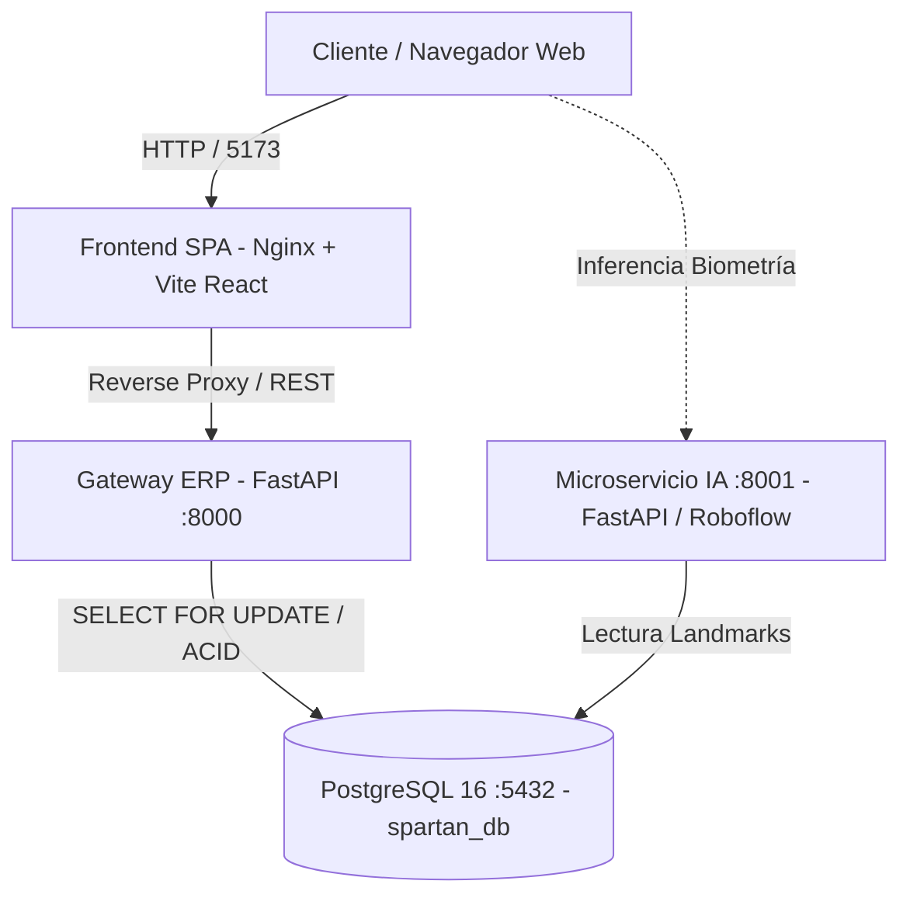

# Spartan Suplementos Bolivia — Plataforma ERP, Kárdex ACID & Microservicio IA

Sistema transaccional de alto rendimiento para la gestión de inventario deportivo, punto de venta (POS), prescripción biomecánica y comercio de suplementos nutricionales de grado élite en Bolivia.

---

## Arquitectura del Sistema

El proyecto implementa una **arquitectura desacoplada en 4 capas contenerizadas**:



1. **Frontend SPA (`frontend/`)**: Construido con React 18, TypeScript, Tailwind CSS, Framer Motion y Sonner, empaquetado y servido a través de Nginx optimizado con compresión Gzip y encabezados defensivos de seguridad.
2. **Gateway ERP Transaccional (`app/`)**: API REST asíncrona construida en FastAPI, encargada de la autenticación OAuth2/JWT (RBAC), control de inventario y punto de venta con transacciones atómicas garantizadas bajo PostgreSQL.
3. **Microservicio de IA Desacoplado (`services/ia/`)**: Servicio autónomo especializado en inferencia de visión artificial, cálculo de somatotipos y prescripciones cruzadas, sin saturar el Event Loop transaccional del ERP.
4. **Base de Datos Relacional (`spartan-db`)**: PostgreSQL 16 estructurada en 3 esquemas limpios (`parametros`, `erp`, `ia`), aplicando restricciones de integridad `CHECK`, claves foráneas y triggers automáticos de Kárdex.

---

## Estructura del Proyecto

```text
Proyecto SS/
├── .env.example              # Plantilla de variables para ejecución local
├── .env.docker.example       # Plantilla segura de variables para Docker
├── docker-compose.yml        # Orquestación de los 4 servicios en contenedores
├── alembic.ini               # Configuración central de migraciones
├── pytest.ini                # Configuración de pruebas automatizadas
│
├── app/                      # NÚCLEO AUTORITATIVO DEL GATEWAY ERP (FastAPI)
│   ├── main.py               # Aplicación FastAPI, CORS seguro y ciclo de vida
│   ├── core/                 # Configuración Pydantic, conexión asyncpg, seguridad y auth
│   ├── models/               # Modelos DeclarativeBase SQLAlchemy 2.0 (ERP, Catálogos, IA)
│   └── modules/              # Módulos de dominio desacoplados
│       ├── auth/             # Autenticación, JWT, roles y endpoints /auth
│       ├── catalogo/         # Gestión de productos, categorías y stock
│       └── pos/              # Punto de Venta, facturación y Kárdex ACID
│
├── services/
│   └── ia/                   # Microservicio de IA y Biometría
│       ├── main.py           # Endpoints de visión e inferencia
│       └── config.py         # Configuración y claves Roboflow
│
├── frontend/                 # APLICACIÓN CLIENTE (Vite + React + TS)
│   ├── src/
│   │   ├── api/              # Cliente Axios con interceptor de autenticación
│   │   ├── assets/           # Logos en alta definición y multimedia institucional
│   │   ├── components/       # Componentes modulares por dominio
│   │   │   ├── common/       # Navbar, Layout, ProtectedRoute, ProductCard
│   │   │   ├── catalogo/     # ProductDetailModal, CreateProductModal, InventoryTable
│   │   │   ├── pos/          # ReceiptModal (Comprobante térmico digital)
│   │   │   ├── home/         # CommunitySection (Rutinas inclusivas y comunidad)
│   │   │   └── index.ts      # Barril de reexportación central
│   │   ├── pages/            # Vistas principales: Inicio, Catalogo, POS, Login
│   │   └── types/            # Tipos de datos e interfaces TypeScript
│   └── package.json
│
├── docker/                   # Recetas y configuraciones de contenedores
│   ├── backend.Dockerfile    # Dockerfile para Gateway ERP
│   ├── ia.Dockerfile         # Dockerfile para Microservicio IA
│   ├── frontend.Dockerfile   # Dockerfile multi-stage para Frontend SPA
│   ├── nginx.conf            # Nginx con cabeceras de seguridad y proxy reverso
│   └── backend_entrypoint.sh # Script de espera de base de datos y migraciones
│
├── scripts/                  # Scripts de mantenimiento y semillas de datos
│   ├── seed.py               # Población canónica de catálogo, usuarios y stock
│   ├── clean_categories.py   # Normalización y desduplicación de categorías
│   └── test_conexion.py      # Diagnóstico rápido de conexión asíncrona
│
└── tests/                    # SUITE DE PRUEBAS AUTOMATIZADAS (Pytest)
    ├── test_auth.py          # Pruebas de login, JWT y permisos por rol
    ├── test_kardex_acid.py   # Pruebas de concurrencia y transaccionalidad ACID
    └── test_pos.py           # Pruebas integrales de flujo de venta y stock
```

---

## Buenas Practicas de Seguridad Implementadas

1. **Gestión Hermética de Secretos**: `.env`, `.env.docker` y variantes están estrictamente excluidos de control de versiones mediante `.gitignore`. Se proporcionan archivos `.example` debidamente sanitizados.
2. **CORS con Orígenes Confiables**: Se eliminó el comodín inseguro `*` en presencia de credenciales; ahora se controlan orígenes específicos vía variable de entorno `CORS_ORIGINS`.
3. **Encabezados Defensivos HTTP en Nginx**:
   - `X-Frame-Options: SAMEORIGIN` (Protección contra Clickjacking).
   - `X-Content-Type-Options: nosniff` (Prevención de MIME Sniffing).
   - `X-XSS-Protection: 1; mode=block` (Mitigación contra ataques XSS).
   - `Referrer-Policy: strict-origin-when-cross-origin`.
   - `Permissions-Policy: camera=(), microphone=(), geolocation=()`.
4. **Hashing Criptográfico de Contraseñas**: Implementación nativa de `bcrypt` con salting individual para evitar ataques de diccionario o tablas arcoíris.
5. **Autenticación Basada en Roles (RBAC)**: Dependencias inyectadas `require_roles("ADMINISTRADOR", "CAJERO")` para proteger endpoints críticos de administración de stock y ventas.
6. **Bloqueo Pesimista en Inventario (ACID)**: Uso de transacciones atómicas con `SELECT ... FOR UPDATE` en PostgreSQL, previniendo quiebres de stock o ventas fantasma en alta concurrencia.

---

## Despliegue Rapido con Docker

### Requisitos Previos
- Docker Desktop o Docker Engine con Docker Compose instalado.

### Puesta en Marcha
1. Crear el archivo de variables para Docker:
   ```bash
   cp .env.docker.example .env.docker
   ```
2. Construir y levantar todos los contenedores en segundo plano:
   ```bash
   docker compose up --build -d
   ```
3. Acceder a los servicios:
   - **Frontend Web**: [http://localhost:5173](http://localhost:5173)
   - **API Gateway ERP**: [http://localhost:8000/docs](http://localhost:8000/docs)
   - **Microservicio IA**: [http://localhost:8001/health](http://localhost:8001/health)
   - **PostgreSQL**: `localhost:5433`

---

## Ejecucion de Pruebas Automatizadas

El proyecto cuenta con una suite integral de 13 pruebas que validan autenticación, RBAC y transaccionalidad ACID:

```bash
# Ejecutar todas las pruebas con pytest
.\venv\Scripts\python.exe -m pytest -v

# Verificar el estado actual de migraciones Alembic
.\venv\Scripts\python.exe -m alembic current
```

---

## Ejecucion en Entorno Local (Desarrollo sin Docker)

### Backend:
```bash
# Activar entorno virtual
.\venv\Scripts\activate

# Iniciar Gateway ERP
uvicorn app.main:app --reload --port 8000
```

### Frontend:
```bash
cd frontend
npm install
npm run dev
```
Acceder a [http://localhost:5173](http://localhost:5173).