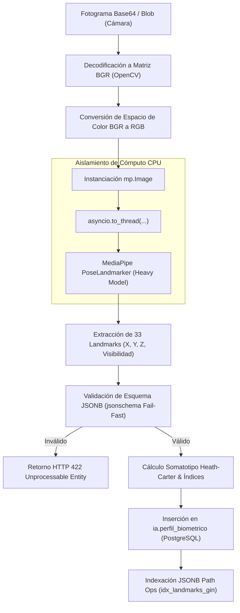
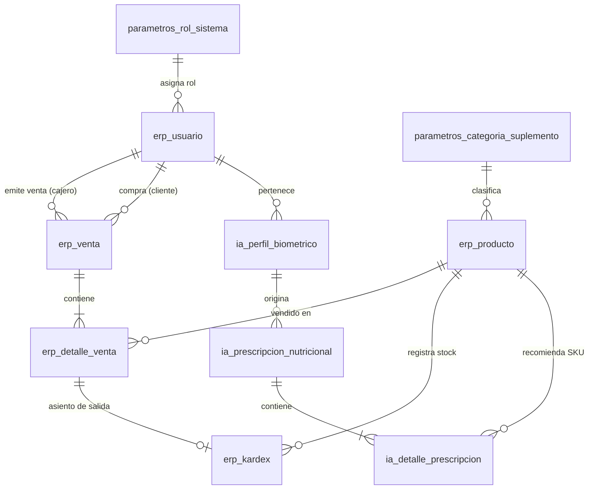
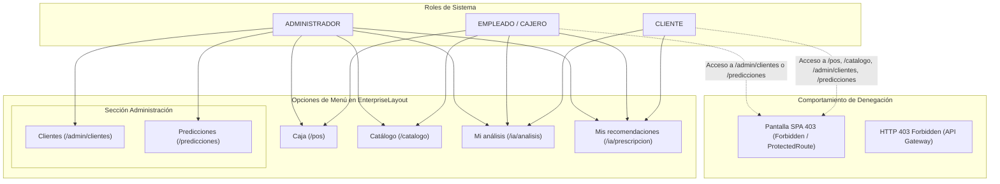
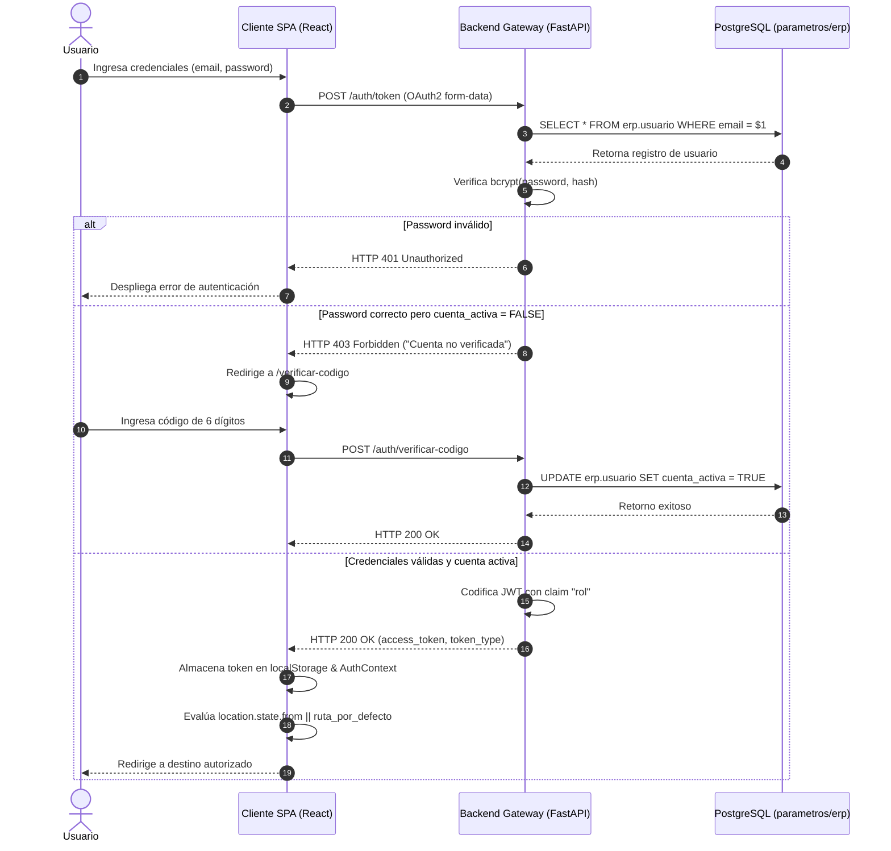
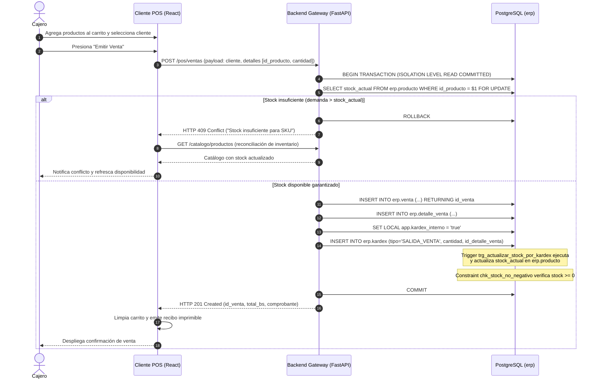
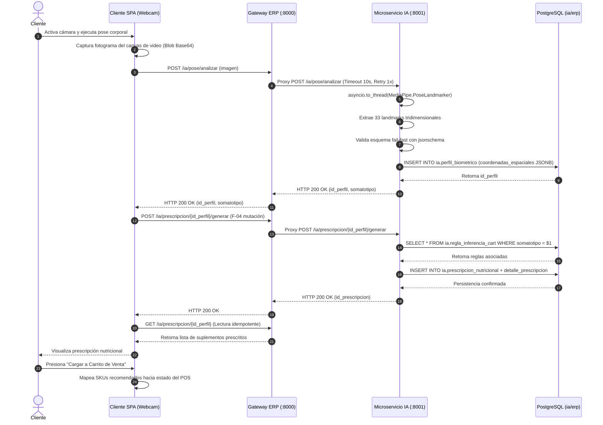

# Mapeo Técnico del Sistema Spartan Suplementos Bolivia

Documento de referencia arquitectónica, operativa y funcional del sistema. Construido mediante inspección estática del repositorio y diagnóstico de la infraestructura en ejecución.

---

## 1. Resumen Ejecutivo

El sistema Spartan Suplementos Bolivia es una plataforma de software orientada a la gestión comercial, prescripción nutricional biomecánica y optimización de inventarios para el sector de suplementación deportiva e indumentaria fitness. La arquitectura desacopla responsabilidades en tres dominios tecnológicos complementarios:

1. **Dominio ERP Transaccional (Gateway Backend)**: Implementado en Python con FastAPI y PostgreSQL 16. Gestiona la autenticación RBAC, catálogo de productos multi-categoría, punto de venta (POS) en tiempo real, control de stock permanente bajo partida doble (kárdex) y balance financiero.
2. **Dominio de Inteligencia Artificial (Microservicio IA)**: Implementado en Python con FastAPI, MediaPipe PoseLandmarker, Scikit-Learn y OpenCV. Procesa visión artificial para la estimación tridimensional de landmarks anatómicos, clasifica somatotopos mediante el método antropométrico Heath-Carter, genera prescripciones nutricionales con árboles de decisión CART y pronostica demanda y quiebres de inventario mediante ensambles Random Forest.
3. **Dominio de Cliente SPA (Frontend Web)**: Implementado en TypeScript con React 18, Vite y Tailwind CSS. Provee interfaces diferenciadas por rol operativo (Administrador, Empleado/Cajero y Cliente) con actualización reactiva de inventarios, captura de video en vivo y visualización analítica.

El funcionamiento operativo del sistema se sintetiza en cinco flujos nucleares:

- **Flujo de Venta POS**: Selección interactiva de productos, asignación de cliente, cálculo financiero y emisión atómica de transacción bajo control de concurrencia optimista, mutando el inventario disponible exclusivamente a través de asientos de kárdex con verificación estricta de stock no negativo.
- **Flujo de Captura Biométrica**: Adquisición de fotogramas desde la cámara web del cliente o estación de escaneo, transmisión segura hacia el gateway, procesamiento en subproceso no bloqueante con MediaPipe, extracción y normalización de 33 coordenadas tridimensionales y persistencia del perfil antropométrico.
- **Flujo de Prescripción Nutricional**: Evaluación de proporciones biométricas y objetivos deportivos mediante el motor determinista CART, generación de combinaciones de suplementos recomendados y transferencia directa de los SKUs hacia el carrito de venta POS.
- **Flujo de Predicción de Demanda**: Ejecución de modelos de ensamble Random Forest Regressor y Classifier sobre series de tiempo y variables de rotación para anticipar la demanda semanal y alertar sobre probabilidades de rotura de stock.
- **Flujo de Reentrenamiento y Promoción**: Despacho de pipelines de reentrenamiento asíncrono desacoplados del ciclo HTTP principal, evaluación automatizada de métricas de calidad (*gates* de promoción) y actualización transaccional de la versión activa en el registro central de modelos.

---

## 2. Topología de Despliegue

### 2.1 Especificación de Contenedores

La infraestructura se encuentra orquestada mediante Docker Compose v2 sobre una red puente aislada (`spartan-network`).

| Servicio | Contenedor | Imagen / Dockerfile | Puerto Interno | Puerto Host | Volúmenes Montados | Red | Política de Reinicio | Healthcheck |
| :--- | :--- | :--- | :---: | :---: | :--- | :--- | :---: | :--- |
| `db` | `spartan-db` | `postgres:16-alpine` | 5432/tcp | 5433 | `postgres_data:/var/lib/postgresql/data` | `spartan-network` | `always` | `pg_isready -U spartan_user -d spartan_db` (int: 5s, timeout: 5s, retries: 5) |
| `backend` | `spartan-backend` | `docker/backend.Dockerfile` | 8000/tcp | 8000 | `./app:/app/app`<br>`./backend:/app/backend`<br>`./tests:/app/tests`<br>`./data:/app/data`<br>`./artifacts:/app/artifacts`<br>`./scripts:/app/scripts` | `spartan-network` | `always` | `curl -f http://localhost:8000/health` (int: 10s, timeout: 5s, retries: 3) |
| `ia` | `spartan-ia` | `docker/ia.Dockerfile` | 8001/tcp | 127.0.0.1:8001 | `./services/ia:/app/services/ia`<br>`./data:/app/data`<br>`./artifacts:/app/artifacts` | `spartan-network` | `always` | `curl -f http://localhost:8001/health` (int: 10s, timeout: 5s, retries: 3) |
| `frontend` | `spartan-frontend` | `docker/frontend.Dockerfile` | 80/tcp | 5173 | (Build multi-stage Nginx estático) | `spartan-network` | `always` | N/A (Monitoreo de puerto Nginx) |

### 2.2 Diagrama de Red y Puertos

```mermaid
graph TD
    ClientBrowser["Navegador Cliente / Terminal POS"]
    
    subgraph HostPorts["Puertos de Entrada Host"]
        P5173["0.0.0.0:5173 (Frontend SPA)"]
        P8000["0.0.0.0:8000 (Gateway Backend)"]
        P8001["127.0.0.1:8001 (Microservicio IA - Loopback)"]
        P5433["0.0.0.0:5433 (PostgreSQL Externo)"]
    end

    subgraph SpartanNetwork["Docker Bridge Network: spartan-network"]
        FrontendContainer["spartan-frontend<br>(Nginx :80)"]
        BackendContainer["spartan-backend<br>(FastAPI Uvicorn :8000)"]
        IAContainer["spartan-ia<br>(FastAPI Uvicorn :8001)"]
        DBContainer["spartan-db<br>(PostgreSQL 16 :5432)"]
    end

    ClientBrowser -->|HTTP GET / Assets| P5173
    ClientBrowser -->|HTTP REST /auth, /pos, /catalogo, /ia, /predicciones| P8000
    
    P5173 --> FrontendContainer
    P8000 --> BackendContainer
    P8001 -.-> IAContainer
    P5433 -.-> DBContainer

    BackendContainer -->|HTTP Proxy / Inferencia| IAContainer
    BackendContainer -->|TCP PostgreSQL Pool (SQLAlchemy / psycopg2)| DBContainer
    IAContainer -->|TCP PostgreSQL Read/Write (psycopg2)| DBContainer
```

### 2.3 Estado Operacional en Tiempo de Ejecución

Verificación ejecutada mediante `docker compose ps` sobre la estación host:

```text
NAME               IMAGE                   COMMAND                  SERVICE    CREATED          STATUS                    PORTS
spartan-backend    proyecto-ss-backend     "uvicorn app.main:ap…"   backend    32 minutes ago   Up 32 minutes (healthy)   0.0.0.0:8000->8000/tcp
spartan-db         postgres:16-alpine      "docker-entrypoint.s…"   db         32 minutes ago   Up 32 minutes (healthy)   0.0.0.0:5433->5432/tcp
spartan-frontend   proyecto-ss-frontend    "/docker-entrypoint.…"   frontend   32 minutes ago   Up 32 minutes             0.0.0.0:5173->80/tcp
spartan-ia         proyecto-ss-ia          "uvicorn services.ia…"   ia         32 minutes ago   Up 32 minutes (healthy)   127.0.0.1:8001->8001/tcp
```

---

## 3. Arquitectura Backend (Gateway ERP)

### 3.1 Módulos Funcionales

El código del gateway se ubica en `app/modules/`, segmentado en componentes de responsabilidad única:

- **`auth`** (`app/modules/auth/`): Gestión del ciclo de vida de identidades, autenticación con credenciales, generación y firma de JSON Web Tokens (JWT), verificación de cuentas vía código numérico temporal (15 min) y recuperación de credenciales.
- **`catalogo`** (`app/modules/catalogo/`): Administración de productos y categorías. Regula precios, stocks mínimos y máximos, unidades de medida y desactivación lógica (`estado_activo = FALSE`).
- **`pos`** (`app/modules/pos/`): Núcleo transaccional de venta. Procesa órdenes comerciales, valida disponibilidad de stock, emite recibos, expone el selector de clientes y gestiona el kárdex permanente de inventarios.
- **`ia`** (`app/modules/ia/`): Fachada y proxy hacia el microservicio `spartan-ia`. Gestiona el almacenamiento y búsqueda de perfiles biométricos, orquesta la invocación del motor CART y coordina la generación asíncrona de prescripciones.
- **`predicciones`** (`app/modules/predicciones/`): Provee el dashboard analítico de inventario, expone estimaciones de rotura de stock y despacha trabajos de reentrenamiento de modelos analíticos en segundo plano.

### 3.2 Pila de Middleware Activo

Configurados centralizadamente en `app/main.py` y `app/core/middleware.py`:

1. **`CORSMiddleware`** (`app/main.py:27-35`): Regula el intercambio de recursos de origen cruzado para orígenes explícitos (`http://localhost:5173`, `http://127.0.0.1:5173`), permitiendo envío de credenciales (`allow_credentials=True`), cabeceras abiertas y verbos HTTP estándar.
2. **`RequestIDMiddleware`** (`app/core/middleware.py:15-28`): Intercepta cada solicitud entrante, extrae o genera un identificador único global `X-Request-Id` (UUID v4), lo vincula al contexto de logs (`logger.bind(request_id=...)`) y lo anexa a la cabecera de respuesta HTTP.
3. **`MetricsMiddleware`** (`app/core/middleware.py:31-52`): Captura la latencia de procesamiento por solicitud mediante `time.perf_counter()`, actualiza contadores atómicos y alimenta el histograma de tiempos de respuesta por ruta y código de estado.
4. **Manejador Global de Excepciones** (`app/main.py:46-56`): Captura cualquier falla no controlada (`Exception`), registra la traza de pila con su correspondiente `X-Request-Id` y emite una respuesta JSON HTTP 500 normalizada: `{"error": "Internal server error", "request_id": "<uuid>"}`.

### 3.3 Mecanismos de Seguridad y RBAC

- **Autenticación**: Basada en OAuth2 Password Bearer (`app/core/security.py`). Las contraseñas se almacenan mediante hashing criptográfico `bcrypt` con factor de coste de trabajo estándar.
- **Tokens**: Emisión de tokens de acceso JWT firmados mediante algoritmo simétrico `HS256` con expiración parametrizada (`ACCESS_TOKEN_EXPIRE_MINUTES`).
- **Claims**: El token codifica en su payload el identificador (`sub`), correo (`email`) y el rol de sistema (`rol`).
- **Dependencias de Autorización**:
  * `get_current_user` (`app/core/dependencies.py:32-68`): Valida la firma del token, verifica su vigencia temporal y comprueba que la cuenta de usuario se encuentre activa (`cuenta_activa = TRUE`).
  * `require_roles` (`app/core/dependencies.py:71-92`): Fabrica evaluadores de acceso que interceptan el claim `rol`. Valida membresía en la lista de roles autorizados. Implementa expansión de compatibilidad de roles: el rol funcional `CAJERO` se homologa a la entidad `EMPLEADO` (`app/core/dependencies.py:77`).

#### Matriz de Roles en Base de Datos (`parametros.rol_sistema`)

| ID Rol | Nombre Formal | Propósito del Rol |
| :---: | :--- | :--- |
| `1` | `ADMINISTRADOR` | Acceso irrestricto: administración de catálogo, usuarios, kárdex, POS, analítica y reentrenamiento ML. |
| `2` | `EMPLEADO` | Operación comercial estándar: emisión de ventas POS, consulta de catálogo y asistencia en captura biométrica. Homologado como `CAJERO`. |
| `3` | `CLIENTE` | Autoservicio: visualización de perfil personal, escaneo biométrico y consulta de prescripciones nutricionales propias. |

#### 3.3.1 Declaración de Acceso por Rol a Dato Biométrico Sensible y Auditoría de Accesos Administrativos

1. **Clasificación y Principio de Privacidad**:
   Las coordenadas anatómicas espaciales tridimensionales (MediaPipe PoseLandmarker), mediciones corporales y diagnósticos de somatotipo Heath-Carter registrados en `ia.perfil_biometrico` constituyen **datos personales sensibles de salud y morfología corporal**. Su tratamiento se encuentra blindado bajo segregación RBAC estricta:
   - **Rol `CLIENTE`**: Acceso exclusivamente vertical y confinado a sus propios perfiles y prescripciones asociadas a su cuenta activa (`current_user.id_usuario`).
   - **Roles `EMPLEADO` / `CAJERO`**: Autorizados a iniciar la captura en estación asistida y transferir prescripciones activas al carrito POS, pero carecen de privilegios para consultar historiales de terceros o listar carteras de clientes fuera de la orden de venta activa. Las rutas `/admin/clientes` y `/admin/clientes/{id_usuario}` retornan `HTTP 403 Forbidden` ante cualquier intento de invocación.
   - **Rol `ADMINISTRADOR`**: Acceso de supervisión clínica integral a través del módulo de administración (`/admin/clientes`), habilitado para auditar la adherencia de planes nutricionales, evolución somatotípica y efectividad de conversión en ventas.

2. **Declaración de Trabajo Futuro (Auditoría Administrativa Inmutable)**:
   Como evolución arquitectónica para auditorías de cumplimiento normativo y privacidad de datos biométricos, se declara como trabajo futuro la incorporación de la tabla `erp.auditoria_acceso_biometrico` gestionada por trigger o middleware asíncrono, la cual registrará de forma inmutable:
   - Identificador del administrador consultante (`id_usuario_admin`).
   - Identificador del cliente consultado (`id_cliente_objetivo`).
   - Timestamp UTC de alta precisión (`accessed_at`).
   - Dirección IP y `User-Agent` de la solicitud.
   - Hash del payload consultado para garantizar no repudio.

### 3.4 Tabla Maestra de Endpoints (Gateway Backend)

Generada mediante inspección estática de los routers en `app/modules/*` y `app/main.py`. Se verifica que todas las operaciones `GET` carecen de efectos colaterales (mutación de datos en esquemas de persistencia).

| Módulo | Verbo | Ruta | Rol Requerido | Propósito Funcional | Esquemas / Tablas Leídas | Esquemas / Tablas Modificadas | Efectos Laterales |
| :--- | :---: | :--- | :--- | :--- | :--- | :--- | :---: |
| `auth` | `POST` | `/auth/token` | Público | Autenticación y emisión de JWT | `erp.usuario`, `parametros.rol_sistema` | Ninguna | Ninguno |
| `auth` | `POST` | `/auth/registro` | Público | Registro de cliente autoservicio | `erp.usuario` | `erp.usuario` | Inserción de usuario inactivo |
| `auth` | `POST` | `/auth/verificar-codigo` | Público | Validación de código de 6 dígitos | `erp.usuario` | `erp.usuario` | Actualiza `cuenta_activa = TRUE` |
| `auth` | `POST` | `/auth/reenviar-codigo` | Público | Regeneración de código de activación | `erp.usuario` | `erp.usuario` | Actualiza código y expiración |
| `auth` | `POST` | `/auth/solicitar-recuperacion` | Público | Emisión de token de reseteo | `erp.usuario` | `erp.usuario` | Genera token de recuperación |
| `auth` | `POST` | `/auth/restablecer-password` | Público | Actualización de clave con token | `erp.usuario` | `erp.usuario` | Actualiza `password_hash` |
| `auth` | `GET` | `/auth/me` | Autenticado | Perfil del usuario en sesión | `erp.usuario`, `parametros.rol_sistema` | Ninguna | **Ninguno (Lectura pura)** |
| `catalogo` | `GET` | `/catalogo/categorias` | Autenticado | Listado de categorías de productos | `parametros.categoria_suplemento` | Ninguna | **Ninguno (Lectura pura)** |
| `catalogo` | `POST` | `/catalogo/categorias` | `ADMINISTRADOR` | Creación de nueva categoría | `parametros.categoria_suplemento` | `parametros.categoria_suplemento` | Inserción de categoría |
| `catalogo` | `GET` | `/catalogo/productos` | Autenticado | Listado filtrado de productos | `erp.producto`, `parametros.categoria_suplemento` | Ninguna | **Ninguno (Lectura pura)** |
| `catalogo` | `POST` | `/catalogo/productos` | `ADMINISTRADOR` | Creación de SKU en catálogo | `erp.producto` | `erp.producto` | Inserción de producto |
| `catalogo` | `GET` | `/catalogo/productos/{id_producto}` | Autenticado | Detalle técnico de un producto | `erp.producto` | Ninguna | **Ninguno (Lectura pura)** |
| `catalogo` | `PUT` | `/catalogo/productos/{id_producto}` | `ADMINISTRADOR` | Actualización de precio o metadata | `erp.producto` | `erp.producto` | Modificación de registro |
| `catalogo` | `DELETE`| `/catalogo/productos/{id_producto}`| `ADMINISTRADOR` | Baja lógica de producto | `erp.producto` | `erp.producto` | Actualiza `estado_activo = FALSE` |
| `pos` | `POST` | `/pos/ventas` | `ADMINISTRADOR`, `EMPLEADO` (`CAJERO`) | Emisión transaccional de venta | `erp.producto`, `erp.usuario` | `erp.venta`, `erp.detalle_venta`, `erp.kardex`, `erp.producto` | Descuenta stock vía trigger kárdex |
| `pos` | `GET` | `/pos/ventas/{id_venta}` | `ADMINISTRADOR`, `EMPLEADO` (`CAJERO`) | Consulta de comprobante de venta | `erp.venta`, `erp.detalle_venta`, `erp.producto` | Ninguna | **Ninguno (Lectura pura)** |
| `pos` | `GET` | `/pos/clientes` | `ADMINISTRADOR`, `EMPLEADO` (`CAJERO`) | Listado para selector POS | `erp.usuario` | Ninguna | **Ninguno (Lectura pura)** |
| `pos` | `GET` | `/kardex/producto/{id_producto}` | `ADMINISTRADOR`, `EMPLEADO` (`CAJERO`) | Historial de movimientos de stock | `erp.kardex`, `parametros.tipo_movimiento_kardex` | Ninguna | **Ninguno (Lectura pura)** |
| `pos` | `GET` | `/kardex/valorizacion/{id_producto}` | `ADMINISTRADOR` | Valorización de inventario en bodega | `erp.kardex`, `erp.producto` | Ninguna | **Ninguno (Lectura pura)** |
| `ia` | `POST` | `/ia/pose/analizar` | Autenticado | Proxy análisis fotograma MediaPipe | Ninguna (Gateway) | Ninguna (Gateway) | Proxy hacia `spartan-ia` |
| `ia` | `GET` | `/ia/perfiles/search` | Autenticado | Búsqueda de perfiles biométricos | `ia.perfil_biometrico` | Ninguna | **Ninguno (Lectura pura)** |
| `ia` | `GET` | `/ia/perfiles/{id_perfil}` | Autenticado | Consulta de perfil biométrico | `ia.perfil_biometrico` | Ninguna | **Ninguno (Lectura pura)** |
| `ia` | `GET` | `/ia/perfiles` | Autenticado | Listado paginado de perfiles | `ia.perfil_biometrico` | Ninguna | **Ninguno (Lectura pura)** |
| `ia` | `GET` | `/ia/prescripcion/{id_perfil}` | Autenticado | Consulta prescripción existente | `ia.prescripcion_nutricional`, `ia.detalle_prescripcion` | Ninguna | **Ninguno (Lectura pura)** |
| `ia` | `POST` | `/ia/prescripcion/{id_perfil}/generar`| Autenticado | Generación de prescripción CART | `ia.perfil_biometrico`, `ia.regla_inferencia_cart` | `ia.prescripcion_nutricional`, `ia.detalle_prescripcion` | Inserción de prescripción |
| `ia` | `GET` | `/ia/prescripcion/{id_perfil}/estado` | Autenticado | Estado de generación asíncrona | `ia.prescripcion_nutricional` | Ninguna | **Ninguno (Lectura pura)** |
| `predicciones`| `GET` | `/predicciones/dashboard` | `ADMINISTRADOR` | Métricas y alertas de inventario | `erp.kardex`, `erp.producto`, `ia.version_modelo_ia` | Ninguna | **Ninguno (Lectura pura)** |
| `predicciones`| `POST`| `/predicciones/reentrenar` | `ADMINISTRADOR` | Despacho de reentrenamiento ML | Ninguna (Gateway) | Ninguna (Despacha tarea) | Inicia tarea BackgroundTasks |
| `predicciones`| `GET` | `/predicciones/reentrenar/estado` | `ADMINISTRADOR` | Monitoreo de job de reentrenamiento | Memoria de proceso / Cache | Ninguna | **Ninguno (Lectura pura)** |
| `admin` | `GET` | `/admin/clientes` | `ADMINISTRADOR` | Listado paginado y filtrado de clientes con último perfil biométrico, prescripciones y plan nutricional (Lateral Join anti-N+1) | `erp.usuario`, `ia.perfil_biometrico`, `parametros.catalogo_somatotipo`, `ia.prescripcion_nutricional`, `parametros.plan_nutricional_somatotipo` | Ninguna | **Ninguno (Lectura pura)** |
| `admin` | `GET` | `/admin/clientes/{id_usuario}` | `ADMINISTRADOR` | Ficha técnica completa de cliente: perfiles ordenados, prescripciones con reglas CART, productos con stock y plan nutricional completo | `erp.usuario`, `ia.perfil_biometrico`, `ia.prescripcion_nutricional`, `ia.detalle_prescripcion`, `erp.producto`, `ia.regla_inferencia_cart`, `parametros.plan_nutricional_somatotipo` | Ninguna | **Ninguno (Lectura pura)** |
| `main` | `GET` | `/health` | Público | Liveness y readiness del backend | `pg_catalog.pg_database` (SELECT 1) | Ninguna | **Ninguno (Lectura pura)** |
| `main` | `GET` | `/metrics` | Público (Red Interna) | Métricas formato Prometheus | Registros de Middleware en memoria | Ninguna | **Ninguno (Lectura pura)** |

---

## 4. Microservicio IA (`services/ia`)

### 4.1 Endpoints y Semántica Operacional

Ubicado en `services/ia/main.py`, se ejecuta de manera independiente en el puerto 8001.

- **`GET /health`**: Verificación de operatividad del runtime de inferencia. Operación idempotente de solo lectura.
- **`POST /ia/pose/analizar`**: Inferencia de visión artificial. Recibe una imagen codificada en Base64 o binario, procesa los 33 puntos corporales, calcula ángulos de simetría y somatotipo, y persiste la información en `ia.perfil_biometrico`.
- **`GET /ia/perfiles/{id_perfil}`**: Recuperación de coordenadas espaciales y métricas del perfil. Operación idempotente de solo lectura.
- **`GET /ia/perfiles`**: Paginación general de perfiles antropométricos. Operación idempotente de solo lectura.
- **`GET /ia/perfiles/search`**: Filtrado de perfiles por cliente o rango de fechas. Operación idempotente de solo lectura.
- **`POST /inferencia/somatotipo`**: Cálculo puro de componentes de Heath-Carter a partir de mediciones manuales o vectoriales, sin interacción con base de datos.
- **`GET /ia/prescripcion/{id_perfil}`**: Obtención de la recomendación suplementaria previamente generada. Operación idempotente de solo lectura (F-04).
- **`POST /ia/prescripcion/{id_perfil}/generar`**: Evaluación del perfil antropométrico mediante las reglas de decisión CART y persistencia de nuevos registros en `ia.prescripcion_nutricional`. Operación de mutación.
- **`GET /ia/prescripcion/{id_perfil}/estado`**: Telemetría de estado del proceso de formulación nutricional. Operación idempotente de solo lectura.

### 4.2 Pipeline de Inferencia Biomecánica



#### Contrato Estructural JSONB (`coordenadas_espaciales`)

El campo `coordenadas_espaciales` en `ia.perfil_biometrico` cumple con la siguiente especificación estricta:

```json
{
  "version_detector": "MediaPipe PoseLandmarker v0.10.x",
  "num_puntos": 33,
  "landmarks": [
    {
      "id": 0,
      "nombre": "nose",
      "x": 0.5124,
      "y": 0.2315,
      "z": -0.1542,
      "visibilidad": 0.9982,
      "presencia": 0.9975
    }
  ],
  "metricas_calculadas": {
    "ancho_biacromial_px": 142.5,
    "ancho_bicristal_px": 118.2,
    "ratio_hombro_cadera": 1.2056,
    "angulo_inclinacion_tronco_deg": 1.45
  }
}
```

### 4.3 Registro de Modelos e Invariantes (`ia.version_modelo_ia`)

El sistema mantiene una única versión activa por familia algorítmica mediante un índice condicional de unicidad en la base de datos:

```sql
CREATE UNIQUE INDEX uq_version_modelo_ia_activa_algoritmo 
ON ia.version_modelo_ia (algoritmo) 
WHERE (activo = TRUE);
```

#### Modelos Activos en Producción

| ID Versión | Algoritmo | Nombre Archivo Artefacto | Métrica Clave | Valor Métrica | Fecha Promoción | Estado |
| :---: | :--- | :--- | :--- | :---: | :---: | :---: |
| `129` | `RF_REGRESOR_DEMANDA` | `artifacts/modelo_regresor_demanda.pkl` | RMSE | 5.5863 | 2026-10-07 | `ACTIVO` |
| `130` | `RF_CLASIFICADOR_QUIEBRE` | `artifacts/modelo_clasificador_quiebre.pkl`| Balanced Accuracy | 0.9383 | 2026-10-07 | `ACTIVO` |

#### Gates de Promoción Automatizada

El script `scripts/promocionar_modelo.py` evalúa de forma determinista la promoción de modelos candidatos antes de activar su bandera en la base de datos:

- **Regresor de Demanda**:
  * Criterio 1: $\frac{\text{RMSE}_{\text{candidato}}}{\text{RMSE}_{\text{baseline}}} \le 0.70$ (Reducción de error mínima del 30%).
  * Criterio 2: Coeficiente de Determinación $R^2 \ge 0.75$.
- **Clasificador de Quiebre**:
  * Criterio 1: Exactitud Balanceada (*Balanced Accuracy*) $\ge 0.80$.
  * Criterio 2: Cobertura de la clase minoritaria (*Recall* $q=1$) $\ge 0.85$.

### 4.4 Motor CART de Prescripción (`ia.regla_inferencia_cart`)

Las reglas deterministas de derivación de suplementos fueron inducidas mediante un árbol de clasificación y regresión (CART) calibrado sobre `data/transacciones_historicas.csv` (`scripts/train_cart.py`).

| ID Regla | Somatotipo Predominante | Objetivo de Entrenamiento | Soporte ($N$) | Confianza / Pureza | Categoría Prescrita | Justificación Fisiológica |
| :---: | :--- | :--- | :---: | :---: | :--- | :--- |
| `1` | Ectomorfo | Hipertrofia Muscular | 142 | 94.3% | `Mass Gainer` + `Creatina` | Déficit calórico estructural; requiere superávit energético y retención intracelular. |
| `2` | Endomorfo | Reducción Grasa / Definición| 188 | 91.5% | `Whey Isolate` + `Termogénico` | Tasa metabólica basal reducida; requiere aislado proteico libre de carbohidratos y estimulación lipolítica. |
| `3` | Mesomorfo | Potencia / Fuerza | 215 | 96.2% | `Whey Concentrada` + `Creatina` | Densidad muscular equilibrada; mantenimiento de síntesis proteica y resíntesis de ATP. |
| `4` | Ecto-Mesomorfo | Resistencia Aeróbica | 89 | 88.7% | `BCAA / Aminoácidos` | Prevención de catabolismo muscular en esfuerzos de larga duración. |
| `5` | Endo-Mesomorfo | Acondicionamiento General | 110 | 92.1% | `Whey Concentrada` | Soporte plástico general sin aporte lipídico excesivo. |

---

## 5. Persistencia y Transaccionalidad

### 5.1 Estructura de Esquemas y Tablas

La persistencia se estructura en tres esquemas PostgreSQL con segregación estricta de dominios:



1. **Esquema `parametros`**:
   - `rol_sistema`: Definición de perfiles de seguridad (`id_rol` PK, `nombre_rol` UQ).
   - `tipo_movimiento_kardex`: Clasificación de operaciones de inventario (`ENTRADA_COMPRA`, `SALIDA_VENTA`, `AJUSTE_INVENTARIO`).
   - `categoria_suplemento`: Taxonomía de artículos (`SUPLEMENTOS`, `INDUMENTARIA`).
   - `objetivo_entrenamiento`: Catálogo de metas biométricas del cliente.
   - `parametro_sistema`: Pares clave-valor de configuración global.
2. **Esquema `erp`**:
   - `usuario`: Cuentas y credenciales (`id_usuario` PK, `email` UQ, `password_hash`, `id_rol` FK, `cuenta_activa`).
   - `producto`: Maestro de artículos (`id_producto` PK, `codigo_sku` UQ, `nombre`, `precio_unitario`, `stock_actual`, `stock_minimo`, `estado_activo`).
   - `orden_compra` y `detalle_orden_compra`: Abastecimiento mayorista.
   - `venta`: Encabezado transaccional (`id_venta` PK, `fecha_venta`, `id_usuario_cajero` FK, `id_usuario_cliente` FK, `total_bs`).
   - `detalle_venta`: Renglones comerciales (`id_detalle_venta` PK, `id_venta` FK, `id_producto` FK, `cantidad`, `precio_unitario`, `subtotal_bs`).
   - `kardex`: Asientos de partida doble (`id_kardex` PK, `id_producto` FK, `id_tipo_movimiento` FK, `cantidad`, `stock_resultante`, `fecha_movimiento`, `id_detalle_venta` FK, `id_detalle_compra` FK).
   - `cierre_caja`: Arqueos de caja operativos.
3. **Esquema `ia`**:
   - `perfil_biometrico`: Capturas articulares (`id_perfil` PK, `id_usuario` FK, `coordenadas_espaciales` JSONB, `somatotipo_calculado`, `fecha_registro`).
   - `prescripcion_nutricional`: Dictámenes CART (`id_prescripcion` PK, `id_perfil` FK, `estado`, `fecha_emision`).
   - `detalle_prescripcion`: Recomendaciones (`id_detalle_prescripcion` PK, `id_prescripcion` FK, `id_producto` FK, `dosis_recomendada`).
   - `version_modelo_ia`: Metadatos de artefactos analíticos (`id_version` PK, `algoritmo`, `ruta_artefacto`, `activo`, `metricas_rendimiento` JSONB).
   - `regla_inferencia_cart`: Árbol de decisiones inducido para derivación nutricional.

### 5.2 Triggers de Kárdex y Protección de Integridad ACID

Para garantizar la no corrupción del inventario físico, el sistema prohíbe la modificación directa de la columna `erp.producto.stock_actual` mediante sentencias `UPDATE` arbitrarias.

- **Variable de Configuración de Usuario (GUC)**: `app.kardex_interno`.
- **Función Guardián**: `erp.fn_proteger_stock_actual()`. Bloquea cualquier actualización sobre `stock_actual` a menos que la transacción haya establecido previamente:
  ```sql
  SET LOCAL app.kardex_interno = 'true';
  ```
- **Trigger de Stock**: `erp.trg_actualizar_stock_por_kardex` se dispara `AFTER INSERT` en `erp.kardex`. Calcula el `stock_resultante` y actualiza la fila de `erp.producto` habilitando internamente la bandera GUC.
- **Constraints CHECK de Integridad**:
  * `chk_stock_no_negativo` en `erp.producto`:
    ```sql
    CONSTRAINT chk_stock_no_negativo CHECK (stock_actual >= 0)
    ```
  * `chk_origen_kardex` en `erp.kardex`:
    ```sql
    CONSTRAINT chk_origen_kardex CHECK (
      (id_detalle_venta IS NOT NULL) OR 
      (id_detalle_compra IS NOT NULL) OR 
      (motivo_ajuste IS NOT NULL)
    )
    ```

**Declaración de Invariante Transaccional**: La columna `erp.producto.stock_actual` muta única y exclusivamente a través de la inserción de asientos válidos en la tabla `erp.kardex`. Cualquier intento de manipulación externa o desbalance de inventario arroja un fallo transaccional inmediato con reversión total (`ROLLBACK`).

### 5.3 Estrategia de Indexación

- **Índice GIN (Generalized Inverted Index)**:
  * `ia.idx_landmarks_gin` sobre `ia.perfil_biometrico (coordenadas_espaciales jsonb_path_ops)`. Optimizado para filtrado por presencia de articulaciones y extracción de predicados JSON sin escanear la tabla completa.
- **Índices B-Tree**:
  * `erp.idx_kardex_producto_fecha`: B-tree sobre `(id_producto, fecha_movimiento DESC)`. Acelera la obtención del último `stock_resultante` y reconstrucciones de kárdex.
  * `erp.idx_venta_fecha`: B-tree sobre `(fecha_venta DESC)` para consultas de facturación diaria y dashboards.
  * `erp.idx_producto_sku`: B-tree único sobre `(codigo_sku)`.
  * `erp.idx_usuario_email`: B-tree único sobre `(email)`.
  * `ia.idx_prescripcion_perfil`: B-tree sobre `(id_perfil)`.

---

## 6. Cliente SPA y Navegación

### 6.1 Tabla de Rutas de la Aplicación

Inspección realizada sobre `frontend/src/App.tsx`.

| Ruta SPA | Componente Vista | Restricción RBAC | Endpoints Backend Consumidos | Estado Local Preservado al Desmontar | Estado Local Descartado al Salir |
| :--- | :--- | :--- | :--- | :--- | :--- |
| `/login` | `Login.tsx` | Público (Redirige si ya está autenticado) | `POST /auth/token` | Ninguno | Credenciales temporales de formulario |
| `/registro` | `Register.tsx` | Público | `POST /auth/registro` | Ninguno | Campos de formulario de registro |
| `/verificar-codigo` | `VerifyCode.tsx` | Público | `POST /auth/verificar-codigo`, `POST /auth/reenviar-codigo` | Ninguno | Dígitos del código numérico |
| `/recuperar-password`| `ForgotPassword.tsx` | Público | `POST /auth/solicitar-recuperacion` | Ninguno | Correo electrónico de recuperación |
| `/restablecer-password`| `ResetPassword.tsx` | Público | `POST /auth/restablecer-password` | Ninguno | Claves de reemplazo |
| `/pos` | `POS.tsx` | `ADMINISTRADOR`, `EMPLEADO` (`CAJERO`) | `GET /catalogo/productos`, `GET /pos/clientes`, `POST /pos/ventas` | Ninguno (E2 diferido) | Contenido del carrito actual, cliente seleccionado |
| `/catalogo` | `Catalogo.tsx` | Autenticado | `GET /catalogo/productos`, `GET /catalogo/categorias`, `POST/PUT/DELETE /catalogo/productos` | Filtro y paginación en URL / estado | Filtros de texto reactivos no confirmados |
| `/ia/analisis` | `AnalisisBiometrico.tsx`| Autenticado | `POST /ia/pose/analizar` | Último perfil capturado en sesión | Stream de video web / buffer de frames |
| `/ia/prescripcion` | `Prescripcion.tsx` | Autenticado | `GET /ia/prescripcion/{id}`, `POST /ia/prescripcion/{id}/generar` | Ninguno | Vista modal de desglose nutricional |
| `/predicciones` | `Predicciones.tsx` | `ADMINISTRADOR` | `GET /predicciones/dashboard`, `POST /predicciones/reentrenar`, `GET /predicciones/reentrenar/estado` | Cache de pestaña activa | Estado efímero de animación de gráficas |
| `/admin/clientes` | `ClientesAdmin.tsx` | `ADMINISTRADOR` | `GET /admin/clientes` | Filtros en query params (`q`, `somatotipo`, `conversion`, `orden`, `desde`, `hasta`, `pagina`) | Ninguno (URL sincronizada bidireccional) |
| `/admin/clientes/:id` | `ClienteDetalleAdmin.tsx` | `ADMINISTRADOR` | `GET /admin/clientes/{id_usuario}` | Ficha activa en memoria | Ninguno |
| `/403` | `Forbidden.tsx` | Público | Ninguno | Ninguno | Ninguno |
| `*` | `NotFound.tsx` | Público | Ninguno | Ninguno | Ninguno |

### 6.2 Layouts y Estructura de Navegación

- **Layout Público / Autenticación**: Renderiza vistas minimalistas centradas en pantalla sin barras de navegación laterales ni cabeceras operativas (`Login`, `Register`, `VerifyCode`).
- **Layout Empresarial (`EnterpriseLayout.tsx`)**: Marco estructural utilizado en rutas privadas.
  * Barra lateral colapsable con accesos directos segmentados por rol.
  * Encabezado superior con breadcrumbs dinámicos, identificador del usuario autenticado, selector de tema oscuro/claro y botón de cierre de sesión.
  * Etiquetas de navegación oficiales:
    - **Caja** (`/pos`): Punto de venta e inventario activo.
    - **Catálogo** (`/catalogo`): Lista de precios y artículos.
    - **Mi análisis** (`/ia/analisis`): Escaneo y captura biomecánica.
    - **Mis recomendaciones** (`/ia/prescripcion`): Protocolos de suplementación.
    - **Clientes** (`/admin/clientes`): Gestión integral de clientes, somatotipos, prescripciones y planes nutricionales (exclusivo para `ADMINISTRADOR`, agrupado junto a Predicciones en la sección de administración).
    - **Predicciones** (`/predicciones`): Inteligencia de negocios y modelos de demanda (exclusivo para `ADMINISTRADOR`).
- **Rutas Protegidas y Redirección con Retorno**:
  * Componente `ProtectedRoute.tsx`: Si no existe sesión válida, extrae la ubicación solicitada mediante `useLocation()` y redirige al usuario hacia `/login` inyectando `state: { from: location }`.
  * Tras autenticación exitosa en `Login.tsx`, el enrutador inspecciona `location.state?.from?.pathname` o el parámetro URL `?redirect=`. Si existe un destino previo, conduce al usuario directamente a él; en su ausencia, aplica la ruta por defecto según el rol.

### 6.3 Guía de Navegación Operativa por Rol



#### Comportamiento Detallado por Rol

1. **ADMINISTRADOR**:
   - Menú visible: Caja, Catálogo, Mi análisis, Mis recomendaciones, Clientes, Predicciones.
   - Rutas permitidas: Acceso irrestricto a todas las rutas del sistema.
   - Recorrido de tareas:
     * *Vender*: Ingresa a Caja -> Selecciona cliente -> Agrega SKUs -> Emite venta -> Visualiza comprobante.
     * *Supervisar Clientes y Planes*: Ingresa a Clientes (`/admin/clientes`) -> Filtra por somatotipo/conversión/fechas -> Accede a la ficha detallada (`/admin/clientes/:id`) -> Examina evolución de perfiles antropométricos, prescripciones históricas con reglas CART y plan nutricional asignado.
     * *Revisar y Reentrenar ML*: Ingresa a Predicciones -> Evalúa tasas de quiebre y RMSE -> Dispara reentrenamiento -> Monitorea barra de progreso asíncrona.
2. **EMPLEADO / CAJERO**:
   - Menú visible: Caja, Catálogo, Mi análisis, Mis recomendaciones.
   - Rutas permitidas: `/pos`, `/catalogo`, `/ia/analisis`, `/ia/prescripcion`.
   - Denegación: Al tipear directamente `/admin/clientes` o `/predicciones` en la barra del navegador, `ProtectedRoute` intercepta la falta de privilegios y despliega la pantalla SPA de error 403 sin fuga de datos. Si invoca la API por fuera del frontend, el gateway retorna `HTTP 403 Forbidden`.
   - Recorrido de tareas:
     * *Vender*: Ingresa a Caja -> Selecciona productos en vitrina -> Emite recibo de venta.
     * *Captura asistida*: Conduce al cliente a Mi análisis -> Inicia cámara -> Ejecuta captura -> Transfiere suplementos prescritos hacia Caja.
3. **CLIENTE**:
   - Menú visible: Mi análisis, Mis recomendaciones.
   - Rutas permitidas: `/ia/analisis`, `/ia/prescripcion`.
   - Denegación: El menú no muestra enlaces a Caja, Catálogo, Clientes ni Predicciones. Intentos de acceso manual hacia `/pos`, `/catalogo`, `/admin/clientes` o `/predicciones` resultan en desvío inmediato a la pantalla SPA 403. Invocaciones directas hacia endpoints de administración arrojan `HTTP 403 Forbidden`.
   - Recorrido de tareas:
     * *Autoservicio biométrico*: Inicia sesión -> Ingresa a Mi análisis -> Activa cámara web -> Realiza pose frontal -> Visualiza somatotipo -> Pasa a Mis recomendaciones para revisar productos compatibles.

### 6.4 Gestión de Estado e Interceptores Cliente

- **Contexto de Autenticación (`AuthContext.tsx`)**: Mantiene el estado reactivo del usuario en memoria (`user`, `token`, `rol`, `isAuthenticated`, `isLoading`).
- **Almacenamiento Local (`localStorage`)**:
  * `token`: JSON Web Token serializado para persistencia entre recargas.
  * `spartan_theme`: Preferencia estética del usuario (`dark` o `light`).
- **Interceptores de Red (Cliente Axios en `frontend/src/api/` o `client.ts`)**:
  * **Interceptor de Solicitud**: Inyecta automáticamente la cabecera `Authorization: Bearer <token>` recuperando el secreto desde `localStorage`.
  * **Interceptor de Respuesta (401 Unauthorized)**: Invalida inmediatamente el token local, resetea el contexto y fuerza la redirección a `/login`.
  * **Interceptor de Respuesta (409 Conflict)**: Intercepta desbalances de stock concurrente en el POS, despliega una alerta modal no disruptiva y desencadena una sincronización en segundo plano del catálogo (`GET /catalogo/productos`).
- **Telemetría en Frontend**: Despacho de eventos DOM custom (`window.dispatchEvent(new CustomEvent('ai-infer-start'))` y `'ai-infer-complete'`) que permiten medir la latencia percibida del renderizado y cálculo en la consola de depuración.

---

## 7. Flujos de Extremo a Extremo

### 7.1 Flujo A: Autenticación, Verificación y Sesión



### 7.2 Flujo B: Venta Transaccional POS con Control de Concurrencia



### 7.3 Flujo C: Captura Biométrica, Prescripción y Derivación Comercial



### 7.4 Flujo D: Reentrenamiento Desacoplado y Promoción de Modelos

```mermaid
sequenceDiagram
    autonumber
    actor Admin as Administrador
    participant SPA as Panel Predicciones (React)
    participant Gateway as Backend Gateway (FastAPI)
    participant Worker as BackgroundTasks Worker
    participant DiskDB as Sistema de Archivos & DB

    Admin->>SPA: Presiona "Reentrenar Modelos"
    SPA->>Gateway: POST /predicciones/reentrenar
    Gateway->>Worker: Encola tarea asíncrona ejecutar_pipeline_ml(job_id)
    Gateway-->>SPA: HTTP 202 Accepted (job_id, estado="EN_PROGRESO")
    
    loop Polling cada 3 segundos
        SPA->>Gateway: GET /predicciones/reentrenar/estado?job_id=...
        Gateway-->>SPA: HTTP 200 OK (progreso_porcentaje, estado)
    end
    
    Worker->>DiskDB: Carga data/train.csv y data/test.csv
    Worker->>Worker: Entrena RF Regresor y RF Clasificador
    Worker->>Worker: Evalúa Gates de Promoción contra test.csv
    alt Supera umbrales de promoción
        Worker->>DiskDB: Guarda artefactos .pkl en artifacts/
        Worker->>DiskDB: BEGIN; UPDATE ia.version_modelo_ia SET activo=FALSE;
        Worker->>DiskDB: INSERT INTO ia.version_modelo_ia (..., activo=TRUE); COMMIT;
        Worker->>Worker: Actualiza estado del job = "COMPLETADO"
    else Falla criterios de calidad
        Worker->>Worker: Descarta versión candidata
        Worker->>Worker: Actualiza estado del job = "FALLIDO_GATES"
    end
    
    SPA->>Gateway: GET /predicciones/reentrenar/estado?job_id=...
    Gateway-->>SPA: HTTP 200 OK (estado="COMPLETADO", nuevas_metricas)
    SPA-->>Admin: Notifica finalización exitosa y refresca métricas en pantalla
```

---

## 8. Pipeline de Datos y Machine Learning

### 8.1 Cadena de Procesamiento Oficial

El ciclo analítico se rige por la cadena de ejecución estandarizada en `data/MANIFIESTO.md`:

$$\text{generar\_dataset\_erp.py} \longrightarrow \text{split\_dataset.py} \longrightarrow \text{train\_modelos.py} \longrightarrow \text{promocionar\_modelo.py} \longrightarrow \text{experimento\_cuasiexperimental.py}$$

1. **Generador del Proceso Generador de Datos (DGP v3)** (`scripts/generar_dataset_erp.py`):
   - Modela 12 meses de operaciones comerciales continuas ($N = 1,123$ transacciones, facturación de 569,680.00 Bs., 30 SKUs).
   - Incorpora tres escenarios de choque estocástico de demanda en el período holdout (noviembre y diciembre de 2025) sin campañas publicitarias precursoras (`promo_activa = 0`).
   - Introduce un cambio estructural de tendencia a partir del 2025-12-01 para seis productos clave (`[3, 4, 13, 14, 22, 23]`).
   - Fija la semilla determinista global $\text{seed} = 42$.
2. **Particionado Temporal Estricto** (`scripts/split_dataset.py`):
   - Genera `data/train.csv` (entrenamiento) y `data/test.csv` (holdout temporal).
   - Divide los datos respetando la flecha del tiempo (cero filtración temporal o *data leakage*). Las variables retrospectivas de ventas (`ventas_ultimos_7_dias`, `ventas_ultimos_30_dias`) se computan estrictamente hasta $t-1$.
3. **Entrenamiento de Modelos Supervisados** (`scripts/train_modelos.py`):
   - **`RF_REGRESOR_DEMANDA`**: Entrena un ensamble de 150 árboles para predecir las unidades requeridas en el horizonte $[t, t+6]$ (`demanda_proxima_semana`).
   - **`RF_CLASIFICADOR_QUIEBRE`**: Entrena un clasificador para estimar la probabilidad binaria de rotura de stock en la ventana $[t, t+6]$ (`riesgo_quiebre_stock`).
4. **Validación de Gates y Promoción** (`scripts/promocionar_modelo.py`):
   - Evalúa el desempeño sobre `data/test.csv`. Los modelos que satisfacen los umbrales cuantitativos se serializan en `artifacts/` y se registran en `ia.version_modelo_ia`.
5. **Inducción del Motor CART** (`scripts/train_cart.py`):
   - Entrena un árbol de decisión interpretable sobre `data/transacciones_historicas.csv`, extrayendo las reglas de asociación que vinculan el somatotipo antropométrico con las categorías de suplementación recomendadas en `ia.regla_inferencia_cart`.

### 8.2 Evaluación Cuasiexperimental de Tres Brazos

El experimento formal de validación sobre el conjunto holdout ($N = 172$ transacciones, 1,830 producto-días) evaluó tres políticas operativas:

| Brazo de Evaluación | Política de Control de Inventario | Quiebres Observados | Tasa de Quiebre Relativa | Tasa por 1,000 Producto-Días |
| :--- | :--- | :---: | :---: | :---: |
| **Brazo 0 (Línea Base / Pretest)** | Histórico ERP sin política proactiva | 32 | **18.60%** | **17.49** |
| **Brazo 1 (Control Activo)** | Heurística reactiva Media Móvil 7 días | 5 | **2.91%** | **2.73** |
| **Brazo 2 (Tratamiento)** | Inferencia Random Forest Regressor Promovido | 5 | **2.91%** | **2.73** |

#### Declaración del Hallazgo Científico (Capítulo IV)

1. **Efecto Integral del Sistema (Brazo 2 frente a Brazo 0)**:
   - Se observa una reducción relativa de quiebres de inventario del **+84.38%**, con un Intervalo de Confianza al 95% obtenido por remuestreo bootstrap de **[63.64%, 100.00%]**. Dado que la cota inferior no cruza el cero ($p < 0.05$), el impacto de la digitalización e intervención del sistema es estadísticamente significativo y positivo.
2. **Efecto Específico Atribuible al Algoritmo ML (Brazo 2 frente a Brazo 1)**:
   - Se observa una reducción adicional de **0.00%** (IC 95%: **[0.00%, 0.00%]**).
   - **Hallazgo Negativo**: Ante variaciones bruscas de demanda que carecen de señales precursoras en las series históricas, los modelos supervisados de Machine Learning ofrecen un rendimiento equivalente al de una heurística clásica de alta reactividad. Este resultado constituye un hallazgo científico verificable reportado para la discusión metodológica del proyecto de grado.

### 8.3 Cláusulas de Exclusión de Registros de Auditoría

De acuerdo con `data/MANIFIESTO.md`, para no alterar los saldos de kárdex ni la integridad referencial, queda prohibido eliminar filas de prueba generadas durante las pruebas de interfaz. Los análisis analíticos deben aplicar las siguientes cláusulas SQL de exclusión:

```sql
-- Filtros obligatorios en consultas analíticas y cuasiexperimentales
WHERE v.id_venta <> 13450
  AND p.id_producto <> 205
  AND u.id_usuario <> 23
  AND pb.id_perfil <> 149511
  AND pn.id_prescripcion NOT IN (1319, 1320);
```

---

## 9. Aseguramiento de Calidad (QA) y Observabilidad

### 9.1 Suites Automatizadas y Cobertura de Pruebas

El sistema cuenta con tres niveles de prueba automatizada validados en contenedores:

| Contenedor / Entorno | Herramienta | Comando Oficial de Ejecución | Pruebas Reportadas | Estado Actual |
| :--- | :--- | :--- | :---: | :---: |
| `spartan-backend` | Pytest | `docker exec spartan-backend pytest` | **78 pruebas** | **100% Pasadas** (33.77s) |
| `spartan-ia` | Pytest | `docker exec spartan-ia pytest services/ia/tests` | **16 pruebas** | **100% Pasadas** (12.64s) |
| Host Local (E2E) | Playwright | `npx playwright test` | **12 pruebas** | **100% Pasadas** (13.70s) |

- **Pruebas de Concurrencia y Carga**:
  * Ejecución de pruebas con 50 clientes transaccionales simultáneos sobre el endpoint `POST /pos/ventas` (`tests/test_pos_concurrency.py`).
  * Verificación de exclusión mutua de stock mediante bloqueo por fila (`SELECT FOR UPDATE` y serialización de kárdex).
  * Resultado: Cero ocurrencias de ventas fantasma o saldos negativos en bodega.

### 9.2 Observabilidad, Trazabilidad y Métricas

- **Endpoint `/metrics`**:
  * Implementado sobre FastAPI, expone métricas operativas agregadas en formato estándar de Prometheus.
  * No expone información personal identificable (PII) ni secretos comerciales.
  * *Política de Seguridad y Riesgo Aceptado*: Expuesto sin autenticación para scraping en la red interna de Docker (`http://backend:8000/metrics`). En despliegue perimetral público se aísla mediante bloqueo por proxy inverso o autenticación básica de infraestructura.
- **Trazabilidad Distribuida (`X-Request-Id`)**:
  * Cada petición HTTP entrante recibe un identificador único en `RequestIDMiddleware`.
  * Este UUID se propaga a los registros de logs estructurados del backend, a las peticiones delegadas al microservicio IA y a la cabecera devuelta al navegador del cliente. Permite la reconstrucción unívoca de incidentes y latencias a través de los contenedores.

---

## 10. Configuración, Entorno y Operación

### 10.1 Variables de Entorno

Definidas en `.env` y documentadas en `.env.example`:

| Variable | Servicio | Propósito y Valor Típico | Requisito de Seguridad |
| :--- | :--- | :--- | :--- |
| `DATABASE_URL` | `backend`, `ia` | Conexión PostgreSQL: `postgresql://user:pass@db:5432/spartan_db` | Restringido / Secreto |
| `POSTGRES_USER` | `db` | Usuario maestro de PostgreSQL | Secreto |
| `POSTGRES_PASSWORD` | `db` | Contraseña maestra de PostgreSQL | Secreto |
| `POSTGRES_DB` | `db` | Nombre de la base de datos (`spartan_db`) | Configuración |
| `SECRET_KEY` | `backend` | Clave simétrica para firma criptográfica de JWT | Altamente crítico |
| `ALGORITHM` | `backend` | Algoritmo de firma JWT (`HS256`) | Fijo |
| `ACCESS_TOKEN_EXPIRE_MINUTES`| `backend` | Minutos de vigencia del JWT (`60`) | Operativo |
| `IA_SERVICE_URL` | `backend` | Enlace interno hacia el microservicio (`http://ia:8001`) | Red interna Docker |
| `PORT` | `ia` | Puerto del servidor Uvicorn IA (`8001`) | Configuración |
| `MODEL_STORAGE_PATH` | `ia`, `backend`| Ruta de serialización de artefactos (`/app/artifacts`) | Directorio |
| `VITE_API_URL` | `frontend` | URL base consumida por el cliente SPA (`http://localhost:8000`) | Público |
| `VITE_DEMO_ACCOUNTS` | `frontend` | Habilita botones de credenciales de prueba en `Login.tsx` | Solo compilación demo (`false` por defecto) |

#### Política del Flag `VITE_DEMO_ACCOUNTS` (F-01)

Los botones de acceso rápido con credenciales predefinidas en `frontend/src/pages/Login.tsx` se compilan condicionalmente solo si `VITE_DEMO_ACCOUNTS=true`. Por defecto, la variable se encuentra en `false` o ausente en el archivo `.env.example`. Ningún build orientado a producción incorpora este componente.

### 10.2 Puertos y Semillas

- **Mapeo de Puertos Host**:
  * `5173`: Frontend Web Nginx.
  * `8000`: Gateway Backend FastAPI.
  * `8001`: Microservicio IA (restringido a `127.0.0.1` en la interfaz de bucle invertido).
  * `5433`: PostgreSQL (puerto host alternativo mapeado al 5432 interno del contenedor).
- **Semilla Determinista**:
  * $\text{seed} = 42$ aplicada en `scripts/generar_dataset_erp.py`, `scripts/split_dataset.py`, `scripts/train_modelos.py` y `scripts/experimento_cuasiexperimental.py`.

### 10.3 Comandos Oficiales del Ciclo de Operación

- **Despliegue y Arranque de Contenedores**:
  ```bash
  docker compose up --build -d
  ```
- **Aplicación de Migraciones de Base de Datos**:
  ```bash
  docker exec spartan-backend alembic upgrade head
  ```
- **Ejecución de Suites de Calidad**:
  ```bash
  # Pruebas unitarias y de integración de Backend
  docker exec spartan-backend pytest

  # Pruebas del subsistema de Visión Artificial e Inferencia IA
  docker exec spartan-ia pytest services/ia/tests

  # Pruebas End-to-End de interfaz y flujos de usuario
  npx playwright test
  ```
- **Compilación de Artefacto Frontend para Producción**:
  ```bash
  npm run build
  ```

---

## 11. Discrepancias Técnicas Detectadas

Registro de diferencias identificadas durante la inspección entre el código fuente activo, la documentación previa y los esquemas operativos. No se aplican correcciones de código en este bloque; se documenta su estado y severidad:

| ID | Discrepancia Identificada | Archivos Afectados | Severidad | Estado / Impacto Operacional |
| :---: | :--- | :--- | :---: | :--- |
| **D-01** | **Desactualización documental en diagrama de arquitectura**:<br>`docs/diagramas_arquitectura.md` omite el endpoint `GET /pos/clientes` incorporado en el Bloque 27 y no refleja la segregación del flujo F-04 (`POST /ia/prescripcion/{id}/generar` vs `GET /ia/prescripcion/{id}`). | `docs/diagramas_arquitectura.md` | Menor | Documental. El código fuente en `app/modules/pos/router.py` y `app/modules/ia/router.py` opera correctamente y cuenta con cobertura de pruebas. |
| **D-02** | **Discrepancia nominal de roles entre Base de Datos y Código**:<br>La tabla `parametros.rol_sistema` contiene el registro `EMPLEADO` (ID 2), mientras que la lógica de autorización en `app/core/dependencies.py:77` expande en memoria los alias `CAJERO` y `EMPLEADO` como equivalentes para compatibilidad con la interfaz. | `app/core/dependencies.py`, `docker/postgres/02_seed_data.sql` | Menor | Arquitectónica. El sistema opera de manera consistente gracias a la expansión en código, pero existe divergencia terminológica entre la capa de persistencia y la de dominio. |
| **D-03** | **Segregación de montaje de volúmenes en contenedores**:<br>El código fuente de `services/ia/` está montado exclusivamente en el contenedor `spartan-ia`. Intentar ejecutar scripts que importen módulos de visión artificial desde el contenedor `spartan-backend` genera `ModuleNotFoundError`. | `docker-compose.yml` | Informativa | Operativa. Requiere que los operadores ejecuten las tareas de IA dentro de `spartan-ia` o en el entorno virtual de la máquina host. |
| **D-04** | **Obsolescencia de diagnósticos en informe UX/UI previo**:<br>El documento `REVISION_UX_UI.md` refleja fallas preexistentes al Bloque 26 (contraste 1.11:1, selector con ID estático 3, doble barra de navegación), las cuales ya fueron subsanadas en el código fuente actual. | `REVISION_UX_UI.md` | Informativa | Documental. Dicho archivo debe considerarse una fotografía histórica previa a las correcciones implementadas en los Bloques 26 y 27. |

---

## Anexo de Reproducibilidad

Comandos exactos ejecutados para la auditoría técnica y extracción de los datos contenidos en este documento:

```bash
# 1. Estado y topología de contenedores Docker
docker compose ps
docker compose config

# 2. Inspección de endpoints en Gateway Backend (AST / grep estático)
grep -RIn "@router\." app/modules/
grep -RIn "@app\." app/main.py

# 3. Inspección de endpoints en Microservicio IA
grep -RIn "@app\." services/ia/main.py

# 4. Inspección de base de datos, triggers y constraints (PostgreSQL)
docker exec spartan-db psql -U spartan_user -d spartan_db -c "\dn"
docker exec spartan-db psql -U spartan_user -d spartan_db -c "\dt erp.*"
docker exec spartan-db psql -U spartan_user -d spartan_db -c "\dt ia.*"
docker exec spartan-db psql -U spartan_user -d spartan_db -c "SELECT id_version, algoritmo, metricas_rendimiento, activo FROM ia.version_modelo_ia;"
docker exec spartan-db psql -U spartan_user -d spartan_db -c "\df+ erp.fn_proteger_stock_actual"

# 5. Inspección de rutas del cliente SPA
grep -RIn "<Route" frontend/src/App.tsx

# 6. Ejecución de suites de prueba automatizadas
docker exec spartan-backend pytest
docker exec spartan-ia pytest services/ia/tests
npx playwright test
```
